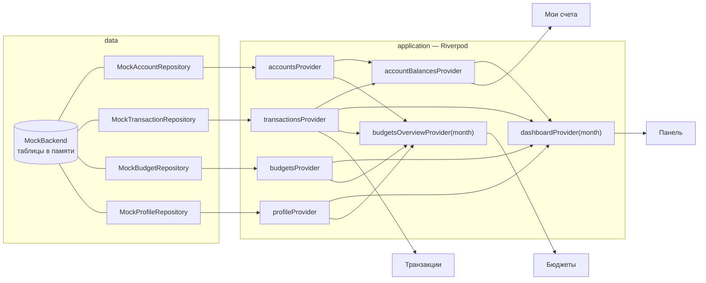

# Отчёт по лабораторной работе L4

**Дисциплина:** Программирование мобильных приложений (PAM), UTM / FCIM / ISA
**Тема:** T7 — WalletMate (личные финансы), уровень сложности «повышенный»
**Автор:** Yang Alexandru, группа `TI-236`
**Этап:** L4 — state management и паттерн Repository на mock-данных
**Дата:** ноябрь 2026

---

## 1. Цель этапа

Отделить экраны от источника данных. На L2–L3 экраны читали константы из
`mock_data.dart` напрямую, и никакое изменение не сохранялось. На L4 между экранами
и данными появляются три слоя:

1. **Доменные модели** (`Account`, `Transaction`, `Budget`, `UserProfile`) по модели
   данных из `docs/er-diagram.md`, с `copyWith`, `toJson` / `fromJson` и равенством
   по значению.
2. **Репозитории**: интерфейс на каждую сущность и mock-реализация поверх
   in-memory бэкенда. Набор операций повторяет контракт API.
3. **Состояние на Riverpod**: провайдеры загружают данные через репозитории,
   держат их в памяти и пересчитывают производные величины (балансы, сводку месяца,
   прогресс бюджетов).

Итог: добавленная, изменённая или удалённая операция сразу видна на всех экранах.
Каждый экран обрабатывает состояния «загрузка», «ошибка», «пусто» и «данные».
На L5 mock-реализации заменяются REST-клиентом, экраны при этом не меняются.

---

## 2. Что сделано

| Требование L4 (из плана L1) | Реализация |
|---|---|
| Riverpod | `flutter_riverpod 3.4`, `ProviderScope` в `main.dart` |
| Доменные модели | `features/*/domain/*.dart`, равенство через `equatable` |
| Репозитории на mock-данных | 4 интерфейса + 4 mock-реализации над общим `MockBackend` |
| Производные агрегаты | Баланс счёта, сводка месяца, структура расходов, прогресс бюджетов — чистые функции + провайдеры поверх них |
| Состояния loading / error / empty | `AsyncValueView` и `RecordPage`; скелетоны, `ErrorState` с «Повторить», `EmptyState` |
| Unit-тесты порогов 89.9 % / 90 % / 100 % (обещано в `er-diagram.md`) | `test/unit/aggregates_test.dart` |

Сверх плана:

- **Демо-данные привязаны к текущей дате.** Это полный прошлый месяц и текущий
  до сегодняшнего дня, поэтому панель в любой день открывается на месяце с данными.
- **Имитация сбоя сети** в профиле (только в debug-сборке): на защите можно
  показать состояние ошибки, не отключая интернет.
- **Pull-to-refresh** на всех списках.
- **Переключатель месяца** на панели (на L2–L3 месяц был зашит).
- **Диалог удаления счёта** называет количество операций, которые удалятся
  вместе с ним (требование из `api-contract.md`).
- **Сохранение формы ждёт ответа репозитория.** При ошибке форма остаётся открытой
  со всем введённым.

---

## 3. Архитектура

### 3.1. Слои внутри feature

```
features/transactions/
├── domain/          модели и чистые расчёты — без Flutter и Riverpod
│   ├── transaction.dart
│   └── transaction_filter.dart
├── data/            откуда берутся данные
│   ├── transaction_repository.dart        интерфейс (abstract interface class)
│   └── mock_transaction_repository.dart   реализация на L4
├── application/     состояние: провайдеры Riverpod
│   └── transactions_providers.dart
└── presentation/    экраны: только ref.watch / ref.read
```

Так устроены `accounts`, `transactions`, `budgets` и `profile`. У `dashboard` нет
своих данных, только `domain/` (расчёт сводки) и `application/` (сборка панели).

### 3.2. Поток данных



**Источники** — четыре `AsyncNotifier`: `accountsProvider`, `transactionsProvider`,
`budgetsProvider`, `profileProvider`. Каждый загружает коллекцию через свой
репозиторий и содержит методы изменения (`add` / `create`, `save`, `delete`).

**Производные провайдеры** ничего не хранят, а вычисляют значения из источников.
Когда источник меняется, Riverpod сам пересчитывает всё, что от него зависит.
Например, после добавления расхода одновременно обновляются список операций,
баланс счёта, итоги и диаграмма на панели и прогресс бюджета.

### 3.3. Почему баланс не хранится

По модели данных баланс — вычисляемая величина:

```
баланс = initialBalance + Σ доходов − Σ расходов   (по операциям счёта)
```

На L2–L3 баланс был полем mock-объекта и не зависел от операций. Теперь его
считает `computeBalances` в `accountBalancesProvider`. Записать операцию и
«забыть» обновить баланс невозможно.

### 3.4. Замена на L5

Реализацию выбирает ровно одна строка на сущность:

```dart
final transactionRepositoryProvider = Provider<TransactionRepository>(
  (ref) => MockTransactionRepository(ref.watch(mockBackendProvider)),
);
```

На L5 здесь будет `ApiTransactionRepository(ref.watch(dioProvider))`. Экраны и
провайдеры состояния работают с интерфейсом и об этой замене не узнают.

---

## 4. Mock-бэкенд

`MockBackend` (`core/data/mock/mock_backend.dart`) — общее хранилище в памяти, на
котором работают все четыре mock-репозитория. Он ведёт себя как сервер:

| Свойство | Зачем |
|---|---|
| Задержка 350 мс на каждый запрос | Скелетоны и индикаторы загрузки видны так же, как будут видны с сетью |
| Флаг «офлайн» → `NetworkException` | Проверка состояния ошибки; переключатель в профиле (debug) |
| Правила сервера в репозиториях | Уникальное имя счёта и уникальная пара «категория + месяц» бюджета → `ConflictException` (HTTP 409); несуществующий счёт → `NotFoundException` (404); сумма ≤ 0 или категория не того типа → `ValidationException` (400) |
| Каскадное удаление | Удаление счёта удаляет его операции (`ON DELETE CASCADE` из модели данных) |
| Общий экземпляр | Каскад работает между репозиториями: счёт удаляется в одном, операции в другом |

Ошибки репозиториев — это `sealed class RepositoryException` с русским
сообщением для пользователя. На L5 REST-клиент будет переводить HTTP-статусы
в те же классы, и экраны продолжат показывать `error.message`.

**Демо-данные** (`MockSeed.relativeTo(today)`) строятся относительно текущей даты:
полный прошлый месяц (9 операций) и текущий месяц до сегодняшнего дня (до
18 операций). Будущих дат не бывает: операция текущего месяца с днём позже
сегодняшнего просто не попадает в данные. Тесты фиксируют «сегодня» на
18.09.2026 через `todayProvider`, поэтому их ожидания не зависят от дня запуска.

---

## 5. Состояния экранов

| Состояние | Как выглядит | Где реализовано |
|---|---|---|
| Загрузка (первая) | Скелетоны в форме будущего содержимого (карточки панели, строки списка) | параметр `loading` у `AsyncValueView` |
| Загрузка (повторная) | Прежние данные остаются на экране, сверху индикатор pull-to-refresh | поведение Riverpod по умолчанию (`skipLoadingOnRefresh`) |
| Ошибка | «Не удалось загрузить данные», текст причины, кнопка «Повторить» | `AsyncValueView`, `RecordPage` |
| Пусто | `EmptyState` с действием: «Добавить операцию», «Создать бюджет», «Добавить счёт» | экраны |
| Нет записи (`/transactions/tx-999`) | Экран «Страница не найдена» | `RecordPage` |
| Ошибка сохранения | Всплывающее сообщение, форма открыта, введённое на месте | `runRepositoryAction` |

**Автоповтор отключён.** Riverpod 3 по умолчанию повторяет неудачную загрузку
до 10 раз с нарастающей паузой, и всё это время, около 30 секунд, крутится
индикатор. В `ProviderScope` задан `retry: noRetry`, поэтому ошибка видна сразу,
а повтор запускает пользователь кнопкой.

**Параллельные запросы.** Производные провайдеры запускают все нужные загрузки
одновременно (`Future.wait`), а не по очереди. Иначе панель ждала бы четыре
запроса подряд (4 × 350 мс). Это проверяется тестом: список операций появляется
после одной задержки, а не двух.

**Удаление с открытого экрана.** `RecordPage` продолжает показывать последнюю
загруженную запись, даже если она исчезла из данных. Без этого после удаления
операции из её карточки во время анимации закрытия на долю секунды мелькал бы
экран «не найдено».

---

## 6. Деньги и пороги бюджета

Суммы хранятся как `double`: в JSON `decimal(18,2)` приходит числом. Но
складывать их в `double` нельзя: `0.7 + 0.1 + 0.1 == 0.8999999999999999`.
Бюджет, израсходованный ровно на 90 %, показался бы как 89,99 % и не получил бы
жёлтую отметку. Поэтому все суммы и доли считает класс `Money` в целых копейках
(`toCents` → сумма `int` → обратно).

Пороги вынесены в `BudgetStatus.of(progress)`. Им пользуются и расчёт, и виджет
`BudgetProgressBar`, так что в двух местах они разойтись не могут:

| Прогресс | Статус |
|---|---|
| < 0.9 | `normal` |
| ≥ 0.9 и < 1.0 | `warning` |
| ≥ 1.0 | `exceeded` |

**Валюты не смешиваются.** Итоги панели и прогресс бюджетов считаются только по
счетам в валюте по умолчанию из профиля. Счёт «Сбережения» в EUR показан со своим
балансом, но в сумму MDL не входит. Если в профиле сменить валюту на EUR, панель
пересчитается по EUR-счетам.

---

## 7. Тестирование

| Файл | Тестов | Что проверяется |
|---|---|---|
| `unit/aggregates_test.dart` | 19 | Сумма в копейках; русские формы множественного числа; балансы всех демо-счетов; итоги по валютам; сводка сентября (доход 9 200, расход 4 980, доли = 1); месяц по местной дате; пороги **89.9 % / 90 % / 99.99 % / 100 %** и 90 %, набранные суммой с погрешностью `double` |
| `unit/models_test.dart` | 8 | Разбор JSON в формате контракта, `toJson` → `fromJson` без потерь, `copyWith`, демо-данные на 18 сентября и в начале месяца (нет будущих дат) |
| `unit/repositories_test.dart` | 19 | CRUD каждого репозитория; конфликты имени счёта и бюджета; каскадное удаление; проверки суммы, категории и счёта; режим офлайн ничего не меняет |
| `unit/providers_test.dart` | 9 | Через `ProviderContainer`: новая операция меняет баланс, итоги и бюджет; перенос операции между месяцами; удаление счёта убирает его операции; смена валюты меняет панель; неудачное изменение не портит состояние; ошибка загрузки и восстановление |
| `widget/data_flow_test.dart` | 11 | Скелетон до загрузки; ошибка и «Повторить»; ошибка сохранения не закрывает форму; новая операция видна в списке и в счётчике бюджетов на панели; правка, удаление операции, удаление счёта (с числом операций в диалоге), новый счёт, новый бюджет, смена имени, переключение месяца |
| `widget/segment_labels_test.dart` | 2 | Подписи переключателей «Тема» и «Тип счёта» помещаются в одну строку на 360 px; ширина измеряется настоящим шрифтом Inter |
| тесты L2–L3 | 104 | Обновлены под провайдеры (общий помощник `test/helpers/test_app.dart`); список экранов для проверки вёрстки на 360 px дополнен панелью и формой нового счёта |

Результат прогона:

```
$ flutter analyze
No issues found!

$ flutter test
00:12 +172: All tests passed!

$ flutter build web
✓ Built build\web
```

Тестовый помощник `pumpApp` / `createTestContainer` фиксирует «сегодня»
(18.09.2026), обнуляет задержку mock-бэкенда и отключает автоповтор, как в
приложении. Тест скелетона, наоборот, включает задержку 350 мс.

---

## 8. Изменённые и новые файлы

**Новые:**

- `lib/core/data/` — `repository_exception.dart`, `mock/mock_backend.dart`,
  `mock/mock_seed.dart`, `mock/mock_providers.dart`
- `lib/core/state/clock.dart` — `todayProvider`
- `lib/core/utils/money.dart`
- `lib/core/widgets/async_views.dart` — `AsyncValueView`, `RecordPage`
- `lib/core/widgets/month_switcher.dart`, `repository_action.dart`
- `lib/features/*/domain/` — модели, `balances.dart`, `month_summary.dart`,
  `budget_progress.dart`
- `lib/features/*/data/` — интерфейсы репозиториев и mock-реализации
- `lib/features/*/application/` — провайдеры; `home/application/data_refresh.dart`
- `test/helpers/test_app.dart`, `test/unit/{aggregates,models,repositories,providers}_test.dart`,
  `test/widget/data_flow_test.dart`

**Удалён:** `lib/core/mock/mock_data.dart`. Константы и расчёты из него перешли
в демо-данные, доменные функции и провайдеры.

**Изменённые:** все экраны (`ConsumerWidget` / `ConsumerStatefulWidget` вместо
чтения констант), `app.dart` (тема и сессия из провайдеров), `main.dart`
(`ProviderScope`), `app_router.dart` (маршруты с `:id` грузят запись через
`RecordPage`), `AccountCard` и `TransactionRow` (баланс и валюта передаются
явно), `pubspec.yaml` (`flutter_riverpod`, `equatable`), `README.md`,
`docs/er-diagram.md`, `docs/api-contract.md`, `docs/screens.md`.

---

## 9. Принятые решения и их обоснование

| Решение | Почему |
|---|---|
| Riverpod без кодогенерации (`riverpod_generator`) | Провайдеры видны в коде как есть, нет шага `build_runner`; провайдеров немного, шаблонного кода получается мало |
| Модели вручную, без `freezed` | Четыре модели; `copyWith` и JSON пишутся за минуты, а сборка остаётся без кодогенерации |
| `AsyncNotifier` на коллекцию + производные `FutureProvider` | Одна точка изменения на сущность; всё остальное вычисляется и не может рассинхронизироваться |
| Изменение применяется к состоянию после ответа репозитория (без оптимистичного обновления) | При ошибке ничего не нужно откатывать; на L5 сервер может вернуть данные, отличные от отправленных (округление, id) |
| После удаления счёта список операций перезагружается, а не чистится на клиенте | Каскад выполняет сервер; клиент не дублирует его правило |
| `AuthSession` остался `ChangeNotifier` | `GoRouter.refreshListenable` принимает `Listenable`; сам объект отдаётся через `authSessionProvider` |
| Отключён автоповтор Riverpod | Ошибка видна сразу, а не после 30 секунд индикатора |
| Демо-данные относительно текущей даты | Панель открывается на текущем месяце и в любой день показывает данные |
| Поле `kind` у счёта | Иконка и цвет карточки (карта, наличные, вклад) были на L2 только в mock; теперь это поле модели, добавлено в ER-диаграмму и контракт API |
| Начальный баланс задаётся только при создании | По контракту `PUT /accounts/{id}` меняет только название, валюту и тип; дальше баланс определяют операции |

---

## 10. Ограничения и что дальше

| Ограничение | Когда снимается |
|---|---|
| Данные живут в памяти: перезапуск возвращает демо-набор | L5: сервер; L6: локальная БД `drift` |
| Список операций загружается целиком, фильтры применяются на клиенте | L5: серверные фильтры и пагинация из контракта |
| Агрегаты панели считает клиент | L5: `GET /dashboard/summary` и `/budgets` с `spentAmount` |
| Тема и выбранный месяц не сохраняются между запусками | L6: локальное хранилище |
| При выходе данные первого пользователя остаются в памяти | L5: выход сбрасывает провайдеры вместе с токеном |

Следующий этап — **L5**: .NET-бэкенд на основе шаблона курса, JWT и REST-реализации
четырёх репозиториев.
